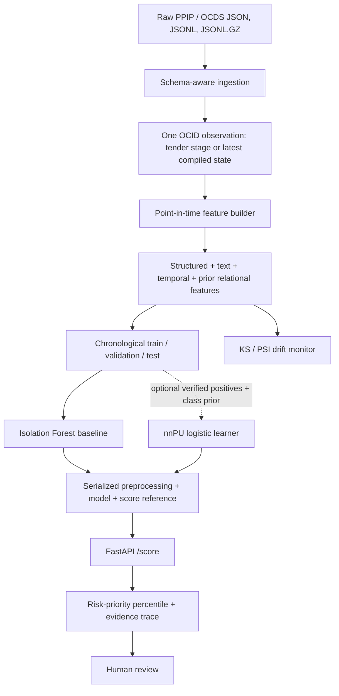

# MTHL: Explainable Procurement Integrity Risk Prioritisation (Kenya)

**DSA 8401 — Applied Machine Learning | MSc Data Science & Analytics**  
**Capstone implementation | Strathmore University / iLabAfrica**

This repository implements a reproducible screening prototype for prioritising Kenyan public-procurement processes for human review. It is based on the accompanying research direction, *A Multimodal Temporal-Hypergraph Learning Framework for Explainable Procurement Integrity Risk Assessment in Kenya*.

The code distinguishes two valid OCDS inputs. With **raw release histories**, it scores a process at its first tender-stage release and reconstructs only earlier release events. With an OCP Registry **compiled-release snapshot**, it scores the latest published process state at the compiled release date. A compiled release is a current-state merge, not a substitute for the original release history; therefore, the registry JSONL alone cannot recreate the exact information available at the first tender publication. The quality report records which mode was used. Do not describe a compiled-snapshot result as an early-warning-at-tender result.

> **Important use limitation:** a high score means that a process is unusual relative to the model's training reference data. It is not a probability of fraud, corruption, collusion or legal wrongdoing. The system is decision support only. It must not automatically reject a supplier, accuse an organisation or trigger enforcement action.

## 1. What the system does

The unit of analysis is one procurement process (`ocid`). The ingestion pipeline converts OCDS JSON, JSONL or JSONL.GZ data into one process-level feature row per OCID. For raw release histories, the score time is the first tender-stage publication timestamp. For compiled snapshots, it is the date of the latest compiled process state. Historical buyer and supplier-concentration summaries use only source events dated strictly before the scoring timestamp; tender text, missingness and interpretable indicators are retained.

The default model is an **Isolation Forest anomaly-ranking baseline** over:

- structured procurement and temporal attributes;
- buyer-level history and prior supplier-concentration features;
- tender titles and descriptions represented with word TF-IDF; and
- missingness indicators and explicit source-coverage fields.

An optional non-negative positive-unlabelled (nnPU) logistic learner is provided for the case where the researcher has a defensible set of traceable positive findings and a justified positive-class prior. It is not run by default. Unlabelled processes are never silently treated as verified legitimate examples.

The service exposes a FastAPI scoring endpoint and returns a priority percentile, a review band, source-traceable indicator notes, a data-confidence note and model metadata. It does not return a fraud probability.

## 2. Architecture



**Conditional bidder-group component.** The pipeline counts only parties explicitly marked with the OCDS `tenderer` role; it never counts an awarded supplier as a competitor. It calculates group and pair recurrence only when at least two tenderer identities are disclosed. The current Open Contracting Partnership registry profile reports no tenderer objects for the Kenya PPRA publication, so this component is expected to be inactive on that snapshot. It is retained as a conditional path for a future or supplementary dataset that genuinely provides tenderer sets. It is not represented as a trained neural hypergraph encoder in this implementation.

## 3. Repository map

```text
src/mthl/                 ingestion, feature building, models, API, monitoring
scripts/                  synthetic smoke-test data generator
data/raw/                 place the downloaded PPIP/OCDS export here (not committed)
data/processed/           processed OCID-level table (not committed, except no raw data)
examples/demo_data/       small synthetic OCDS-like fixture
artifacts/                synthetic demo model for API smoke tests
reports/                  demo data audit and demo evaluation record
proposal/                  one-page capstone proposal draft
docs/                      design notes, notebook audit, model card and data dictionary
tests/                     automated unit and API tests
Dockerfile                 non-root API image
docker-compose.yml         local API service
AI_USE.md                  AI-use disclosure
```

## 4. Quick start (synthetic demonstration)

Python 3.11+ is required. From the repository root:

```bash
python -m venv .venv
source .venv/bin/activate                 # Windows: .venv\Scripts\activate
python -m pip install --upgrade pip
pip install -r requirements-dev.txt
pip install --no-build-isolation --no-deps -e .

python scripts/generate_demo_data.py
mthl ingest --input-dir examples/demo_data \
  --output data/processed/demo_procurements.csv \
  --quality reports/demo_data_quality.json
mthl train --input data/processed/demo_procurements.csv \
  --artifact artifacts/demo_model.joblib \
  --report reports/demo_evaluation.json

pytest -q
uvicorn mthl.api:app --host 0.0.0.0 --port 8000
```

Open `http://localhost:8000/docs` for the interactive API documentation or `http://localhost:8000/health` to inspect the loaded model. Example request:

```bash
curl -X POST http://localhost:8000/score \
  -H 'Content-Type: application/json' \
  -d '{
    "procurement_method": "open",
    "procurement_category": "goods",
    "tender_status": "active",
    "title": "Supply of ICT equipment",
    "description": "Supply and delivery of computers and printers",
    "duration_days": 5,
    "estimated_value_log1p": 15.2,
    "buyer_prior_process_count": 8,
    "buyer_prior_supplier_hhi": 0.62
  }'
```

The synthetic fixture contains 180 fictional processes and 360 fictional raw releases. The resulting model is for integration tests only. **Do not use its scores as findings about Kenya or real procurement.**

## 5. Use the PPIP/OCDS data

The intended public source is the PPRA PPIP OCDS publication listed in the Open Contracting Partnership registry: <https://data.open-contracting.org/en/publication/147>. The original portal is <https://tenders.go.ke/ocds>.

The OCP Registry page describes its JSONL download as one **compiled release** per contracting process. Under OCDS, a compiled release gives the latest values for a process; a record's embedded/linked `releases` are the release history. The registry file is therefore suitable for latest-state screening, but not by itself for reconstructing the first tender-stage state. If your research objective is tender-time early warning, obtain the underlying embedded/raw releases or a versioned record package from PPIP. The parser uses embedded release objects when available, ignores linked references it cannot dereference, and otherwise falls back to compiled-snapshot mode. The chosen mode is written to `reports/data_quality.json`.

1. Obtain the full OCDS JSONL.GZ or release package from the source and retain the original downloaded file unchanged.
2. Place the file under `data/raw/`, for example `data/raw/full.jsonl.gz`.
3. Run:

```bash
mthl ingest --input-dir data/raw \
  --output data/processed/procurements.csv \
  --quality reports/data_quality.json
mthl train --input data/processed/procurements.csv \
  --artifact artifacts/model.joblib \
  --report reports/evaluation.json
```

The ingestion report records source file size and SHA-256, release counts, selected input representation, prediction-time semantics, invalid identifiers/dates, OCID counts, field completeness, tenderer disclosure and the conditional hypergraph availability check. The original data are not included in this repository because they should be separately retained with source, licence/terms and provenance.

### Optional verified-positive / nnPU mode

A positive-label CSV may be supplied only after each finding has been checked for provenance and link confidence. The minimum columns are `ocid` and `published_at` (UTC timestamp at which the finding became public). A template is in `examples/positive_labels_template.csv`.

```bash
mthl train --input data/processed/procurements.csv \
  --artifact artifacts/model_nnpu.joblib \
  --report reports/evaluation_nnpu.json \
  --positive-labels examples/verified_positive_findings.csv \
  --positive-prior 0.02
```

The class prior above is an example only and must be estimated and sensitivity-tested; do not copy it without justification. Training uses only findings published by the end of the chronological training window. Later published findings may be used as retrospective holdout evidence, but never as earlier predictors or training labels. Because audit and sanction outcomes are selected rather than exhaustive, observed-positive retrieval is not full precision/recall over all misconduct.

## 6. Docker deployment

The container uses a non-root application account and reads its model from `/app/artifacts`.

```bash
# Use the included synthetic model for a deployment smoke test
docker compose up --build
```

For the model trained on the real snapshot, update `MTHL_MODEL_PATH` in `docker-compose.yml` to `/app/artifacts/model.joblib` (the `artifacts/` directory is mounted read-only), then rebuild/restart the service. The image contains a demo artifact by default so that the API can start immediately; this must be replaced before any real use.

## 7. Monitoring and experiment tracking

Compare a reference and current processed snapshot:

```bash
mthl-monitor --reference data/processed/train_reference.csv \
  --current data/processed/current_batch.csv \
  --output reports/drift_report.json
```

The monitor calculates numeric KS statistics and PSI, with categorical PSI for selected fields. The implemented checks detect **input/covariate drift only**. They cannot establish concept drift or model degradation without valid later outcome labels. Optional MLflow support:

```bash
pip install -r requirements-mlops.txt
mlflow ui --host 0.0.0.0 --port 5000
mthl train --input data/processed/procurements.csv --mlflow
```

The CLI logs available training parameters and evaluation metrics to a local MLflow tracking server when configured. A production registry, champion/challenger release gate and human approval workflow remain deployment extensions rather than claims about the current prototype.

## 8. Reproducibility, assumptions and limits

- The random seed is recorded; the chronological split uses unique prediction timestamps so ties cannot cross partitions.
- For raw-release mode, features use only publications strictly earlier than the first tender-stage timestamp, and a process's own later award is excluded from its tender-time features.
- For compiled-snapshot mode, the score timestamp is the compiled release date (the latest release date for that process). This supports latest-state review, not reconstruction of the initial tender-time information set.
- Imputation, one-hot encoding, TF-IDF vocabulary and model fitting are learned from the training period for evaluation. The final service artifact is refitted on the complete frozen snapshot only after the out-of-time check.
- The prototype uses a tabular/text anomaly baseline rather than a large graph transformer or a fine-tuned language model. This is deliberate: current bidder disclosure is absent, entity identifiers need validation, verified outcome labels were not supplied, and model complexity must be justified by measurable incremental value.
- The system is not a causal model, a corruption adjudicator or a substitute for procurement expertise.
- Actual PPIP data and independently verified outcome labels were not included in the files supplied for this build. Therefore, this archive contains a tested software pipeline and synthetic integration results, **not a completed empirical evaluation on the Kenyan PPIP dataset**.

See `reports/final_report.md`, `docs/notebook_audit.md`, `docs/model_card.md` and `AI_USE.md` before presenting or deploying the work.
